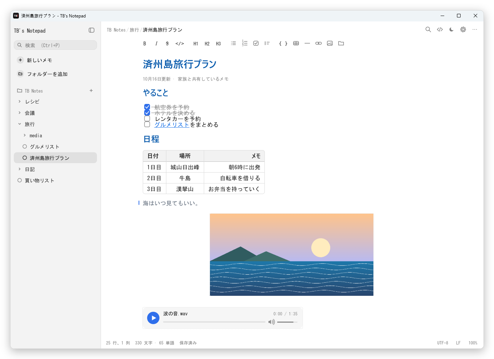
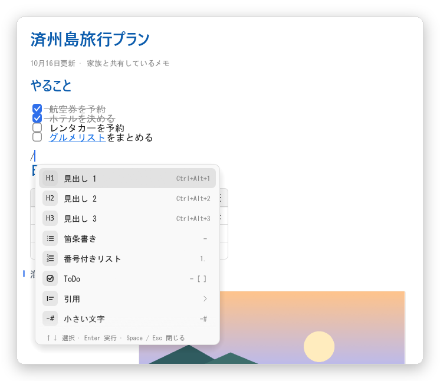
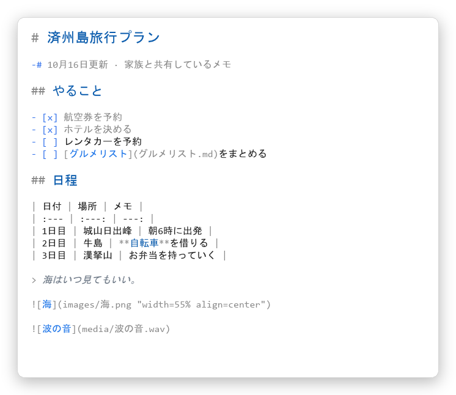
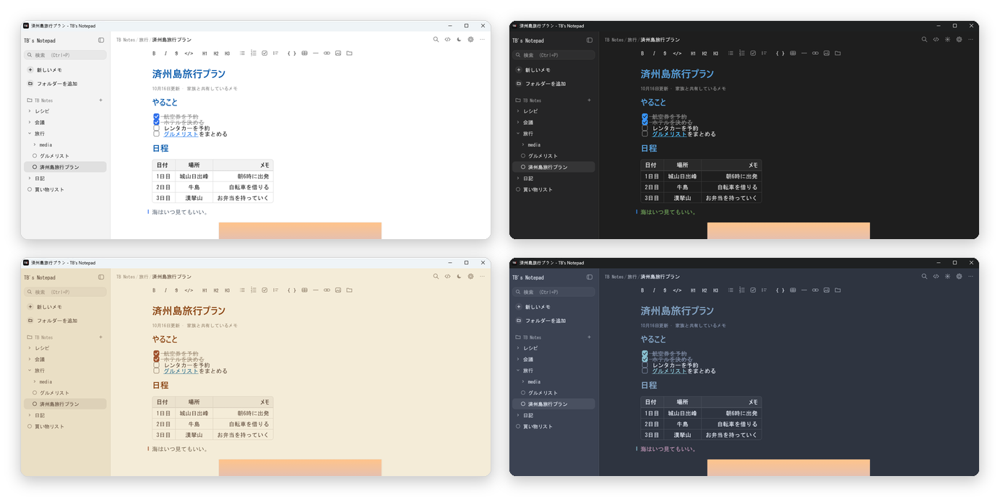

<div align="center">

[English](README.md) · [한국어](README.ko.md) · [简体中文](README.zh-CN.md) · **日本語**


# TB's Notepad

**書いたそばから書式が見える、軽くてかんたんな Windows 用マークダウンメモ帳**

[](https://github.com/tbvwv123/TB-s-Notepad/releases/latest)


[](LICENSE)

<picture>
  <source media="(prefers-color-scheme: dark)" srcset="docs/images/ja/dark.png">
  
</picture>

</div>

## TB's Notepad の特長

- **見たままに書ける** — `# 見出し`、`**太字**`、`- [ ] ToDo` と打つと記号が隠れ、すぐに見出し・太字・チェックボックスになります。記号はカーソルのある行でだけ薄く表示されます。
- **フォルダーで整理** — サイドバーに フォルダー › サブフォルダー › メモ。入力を止めると自動保存され、1 行目がそのままファイル名になります。
- **ただの `.md` ファイル** — メモは PC のフォルダーにふつうのマークダウンファイルとして保存されます。ほかのエディター・クラウド同期フォルダー・Git とそのまま使えます。
- **軽くて静か** — インストールもログインも不要、exe ひとつ (約 13 MB)。インターネットには接続しません。
- **4 言語対応** — 日本語、English、한국어、简体中文。Windows の言語に合わせて表示され、設定 › エディター で変更できます。

## 主な機能

<table>
<tr>
<td width="50%" valign="top">

### ✍️ ドキュメントのように編集
見出し · リスト · ToDo · 引用 · コードブロック · 区切り線 · `-#` 小さい文字がすぐに表示されます。
**表** はセルと線で描かれ、クリックするとソースに戻って編集できます。

</td>
<td width="50%" valign="top">

### 🖼️ 画像 · 音声 · 動画
画像をコピーして **Ctrl+V** するだけ。Word のようにクリックしてサイズ・位置を変えられます。
音声はメモの中ですぐ再生 (再生バー · 音量)、動画は最初の場面を表示します。

</td>
</tr>
<tr>
<td valign="top">

### 🔗 メモどうしのリンク
ほかのメモ · 特定の行 · 見出し · フォルダーへのリンクを Ctrl+クリックでたどれます。
選んだ文字を右クリック › **ハイパーリンクをコピー** でリンクをすぐ作れます。

</td>
<td valign="top">

### ⚡ `/` コマンド
ショートカットを覚えなくても大丈夫。`/` を打って名前で探して実行 — `/表`、`/リンク`、`/h2`。
スペースを打てばただの `/` として残ります。

</td>
</tr>
<tr>
<td valign="top">

### 🎨 テーマとフォント
テーマ 8 種類 + カスタムカラー。本文 · ソース表示 · 画面のフォントを別々に選べ、
太字のないフォントでも見出しは選んだフォントのまま太く表示されます。

</td>
<td valign="top">

### 🤖 AI といっしょに使う
`TB-Notepad.exe --mcp` だけで、Claude などの AI がメモを読み書きできる **ローカル MCP サーバー** になります。
クラウドもログインも不要で、メモフォルダーの外には出ません。→ [詳しく](docs/MCP.ja.md)

</td>
</tr>
</table>

<div align="center">


<br>
<sub>左: <code>/</code> コマンド一覧 · 右: 同じメモのソース表示 (Ctrl+E)</sub>
<br><br>

<br>
<sub>ライト · ダーク · セピア · Nord — テーマは 8 種類 + カスタム</sub>
</div>

## はじめかた

1. [**Releases**](https://github.com/tbvwv123/TB-s-Notepad/releases/latest) から `TB-Notepad.exe` をダウンロードします。
2. 好きな場所に置いて実行します。インストールも追加のランタイムも不要です。
3. 初めて起動すると `ドキュメント\TB Notes` フォルダーと、使い方をまとめた **はじめに** メモが開きます。

> [!NOTE]
> コード署名のない実行ファイルのため、初回起動時に「Windows によって PC が保護されました」と表示されることがあります。**詳細情報 › 実行** を押してください。

- `.md` ファイルをウィンドウにドラッグするか、エクスプローラーの「プログラムから開く」に設定して開けます。
- `.txt` ファイルは書式なしで開き、元のエンコード (UTF-8 · ANSI など) と改行コードのまま保存します。
- 実行ファイルの横に `portable.txt` を置くと、設定を実行ファイルの横に保存する **ポータブルモード** になります。

## 使える記法

| こう書くと | こう表示されます |
| --- | --- |
| `# 見出し` `## 見出し` `### 見出し` | 大きい見出しから小さい見出し |
| `**太字**` `*斜体*` `~~取り消し線~~` `` `コード` `` | **太字** *斜体* ~~取り消し線~~ `コード` |
| `- 項目` · `1. 項目` · `- [ ] ToDo` | 箇条書き · 番号付きリスト · クリックできるチェックボックス |
| `> 引用` · `-# 小さい文字` · `---` | 引用の線 · 小さいグレーの文字 · 区切り線 |
| `\| セル \| セル \|` + `\| --- \| --- \|` | 表 (`:---:` 中央、`---:` 右揃え) |
| `` | サイズ · 位置を指定した画像 |
| `` · `` | 音声カード · 動画カード |
| `[リンク](https://…)` · `[議事録](会議/10月.md#L12)` · `[資料](C:/資料)` | Web リンク · メモの行へのリンク · エクスプローラーへのリンク |

ほかにもコードブロック (```` ``` ````)、HTML への書き出し、検索・置換、ファイル名と内容の検索に対応しています。

<details>
<summary><b>ショートカット</b></summary>

| キー | 動作 |
| --- | --- |
| Ctrl+N | 新しいメモ (今のフォルダーに) |
| Ctrl+P | メモを検索 |
| Ctrl+\\ | サイドバーの表示切り替え |
| F2 | このメモの名前を変更 |
| Ctrl+O / Ctrl+S | ファイルを開く / 保存 |
| Ctrl+F / Ctrl+H, F3 | 検索 / 置換、次を検索 |
| Ctrl+B / I / K | 太字 / 斜体 / リンク |
| Ctrl+Alt+1~3 | 見出し 1~3 |
| `/` | コマンド一覧 (行頭かスペースのあと、スペースで閉じる) |
| Ctrl+Shift+K | メモへのリンクを挿入 |
| Ctrl+Shift+L | この行 (見出し) へのハイパーリンクをコピー |
| Ctrl+クリック | リンクをたどる (Web · メモ · 行 · フォルダー · ファイル) |
| Ctrl+V | 貼り付け (クリップボードに画像だけなら画像) |
| Ctrl+E | マークダウンのソース表示 |
| Ctrl+ホイール, Ctrl+= / - / 0 | 文字サイズ |
| Ctrl+, | 設定 |
| F5 | 日付と時刻を挿入 |
| F11 | 全画面 |

</details>

## よくある質問

<details>
<summary><b>メモはどこに保存されますか？</b></summary>

サイドバーに追加したフォルダーに、ふつうの `.md` ファイルとして保存されます (既定は `ドキュメント\TB Notes`)。
貼り付けた画像はメモ横の `images` フォルダーに PNG で保存されます。設定は `%APPDATA%\tb-notepad` にあります。

</details>

<details>
<summary><b>ほかの PC やスマートフォンでも使えますか？</b></summary>

メモフォルダーを Google Drive · OneDrive · Dropbox などの同期フォルダーに置いてください。
アプリは外部で変わったメモを自動で再読み込みし、両方で変更した場合はどちらを残すか尋ねます。
スマートフォンでは、同じフォルダーを開けるマークダウンエディターで編集できます。

</details>

<details>
<summary><b>ほかのマークダウンアプリと互換性はありますか？</b></summary>

あります。画像のサイズ・位置は標準の画像記法のタイトル部分 — `` — に書くので、
ほかのアプリでも画像が崩れません。リンクはすべて相対パスなので、フォルダーごと移動してもそのまま動きます。

</details>

<details>
<summary><b>macOS や Linux で使えますか？</b></summary>

今のところ Windows 10 · 11 専用です。

</details>

## 開発

Rust と [egui](https://github.com/emilk/egui) で作っています。ビルド方法とコード構成は [docs/DEVELOPMENT.md](docs/DEVELOPMENT.md) (英語)、AI (MCP) 連携は [docs/MCP.ja.md](docs/MCP.ja.md) をご覧ください。

```powershell
powershell -ExecutionPolicy Bypass -File .\build.ps1   # → dist\TB-Notepad.exe
cargo test
```

画面の文言の翻訳は `scripts/i18n_strings.py` にあります。編集したら `python scripts/gen-i18n.py` を実行してください。翻訳の改善も歓迎します！

## ライセンス

[MIT](LICENSE) © 2026 TBvwv123
