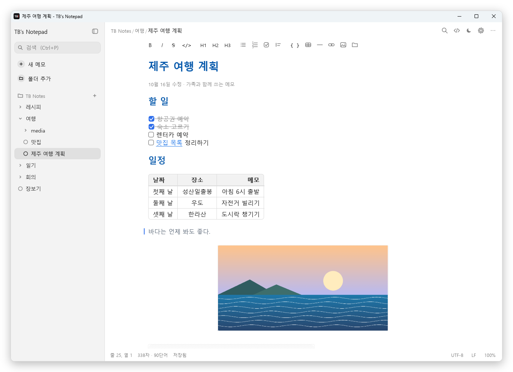
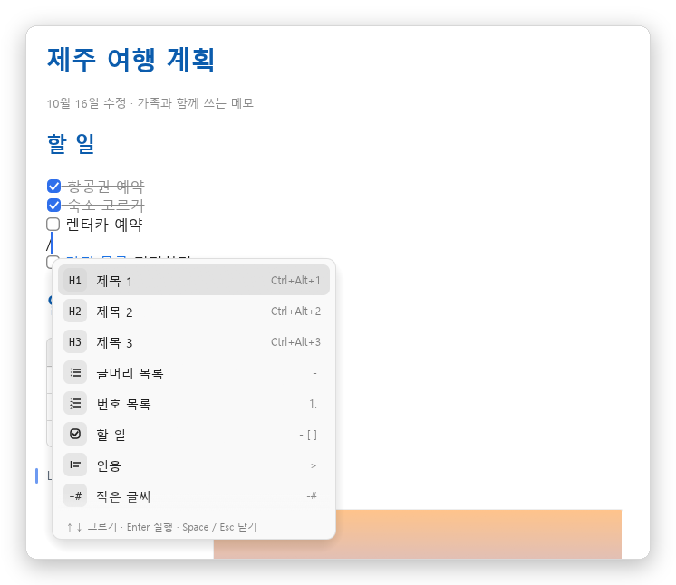
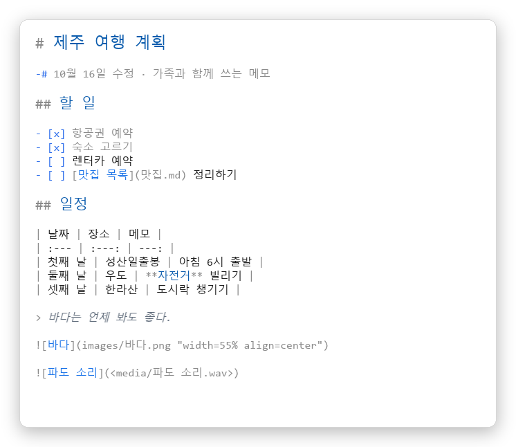
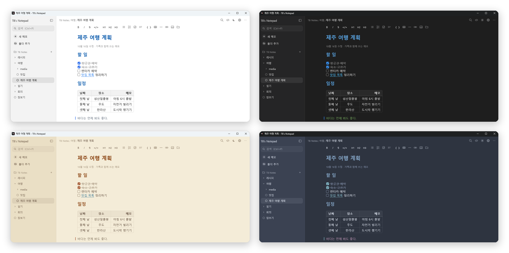

<div align="center">

[English](README.md) · **한국어** · [简体中文](README.zh-CN.md) · [日本語](README.ja.md)


# TB's Notepad

**쓰는 대로 바로 서식이 보이는, 가볍고 쉬운 Windows 마크다운 메모장**

[](https://github.com/tbvwv123/TB-s-Notepad/releases/latest)


[](LICENSE)

<picture>
  <source media="(prefers-color-scheme: dark)" srcset="docs/images/ko/dark.png">
  
</picture>

</div>

## 왜 TB's Notepad?

- **보이는 그대로 쓰기** — `# 제목`, `**굵게**`, `- [ ] 할 일`을 치면 기호는 숨고 바로 제목·굵은 글씨·체크박스가 됩니다. 기호는 커서가 있는 줄에서만 살짝 보입니다.
- **폴더로 정리** — 왼쪽 사이드바에 폴더 › 하위 폴더 › 메모. 입력을 멈추면 자동 저장되고, 첫 줄이 곧 파일 이름이 됩니다.
- **그냥 `.md` 파일** — 내 PC 폴더에 평범한 마크다운 파일로 저장됩니다. 다른 편집기·클라우드 폴더·Git과 그대로 함께 쓸 수 있습니다.
- **가볍고 조용함** — 설치도 로그인도 없이 실행 파일 하나(약 13MB). 인터넷에 연결하지 않습니다.
- **4개 언어** — 한국어, English, 简体中文, 日本語. Windows 언어를 따르고, 설정 › 편집기에서 바꿀 수 있습니다.

## 주요 기능

<table>
<tr>
<td width="50%" valign="top">

### ✍️ 문서처럼 편집
제목 · 목록 · 할 일 · 인용 · 코드 블록 · 구분선 · `-#` 작은 글씨가 바로 보입니다.
**표**는 칸과 선으로 그려지고, 누르면 원문으로 바뀌어 고칠 수 있습니다.

</td>
<td width="50%" valign="top">

### 🖼️ 그림 · 소리 · 영상
그림을 복사해 **Ctrl+V** 하면 끝. 워드처럼 눌러서 크기·위치를 바꿉니다.
소리 파일은 메모 안에서 바로 재생(재생 막대 · 소리 크기), 영상은 첫 장면을 보여 줍니다.

</td>
</tr>
<tr>
<td valign="top">

### 🔗 링크와 태그
다른 메모 · 특정 줄 · 제목 · 폴더로 가는 링크를 Ctrl+클릭으로 따라갑니다.
선택한 글자를 오른쪽 클릭 › **하이퍼링크 복사**로 바로 링크를 만듭니다.
`#태그`를 쓰고 태그별로 모아 봅니다 — `#a #b`(둘 다) · `#a OR #b`(둘 중 하나) · `-#a`(빼기).

</td>
<td valign="top">

### ⚡ `/` 명령
단축키를 몰라도 됩니다. `/`를 치고 이름으로 찾아 실행 — `/표`, `/링크`, `/h2`,
한글 초성 `/ㅁㅁㄹ`도 됩니다. 스페이스를 치면 그냥 `/` 글자로 남습니다. `:이름`으로 내 커스텀 이모지도 넣습니다.

</td>
</tr>
<tr>
<td valign="top">

### 🎨 테마와 글꼴
테마 8가지 + 사용자 지정 색. 본문 · 원본 보기 · 화면 글꼴을 따로 고르고,
굵은 글꼴이 없는 글꼴도 제목이 고른 글꼴 그대로 굵게 보입니다.

</td>
<td valign="top">

### 🤖 AI와 함께 쓰기
`TB-Notepad.exe --mcp` 하나로 Claude 같은 AI가 메모를 읽고 쓰는 **로컬 MCP 서버**가 됩니다.
클라우드도 로그인도 없이, 메모 폴더 밖으로는 나가지 않습니다. → [자세히](docs/MCP.ko.md)

</td>
</tr>
<tr>
<td valign="top">

### 🗂️ 목록과 토글
Enter 로 목록 · 할 일이 이어지고, Tab / Shift+Tab 으로 들여씁니다.
`>>` + 스페이스로 노션 같은 **토글**을 만들고, ▶ 나 Ctrl+Enter 로 접고 폅니다.

</td>
<td valign="top">

### 🛟 옮기기와 되돌리기
사이드바에서 메모 · 폴더를 끌어다 옮기면 그림과 링크가 알아서 고쳐집니다.
**이전 버전**이 고치는 동안 내용을 남겨 둬서, 실수로 지운 것도 되돌릴 수 있습니다.

</td>
</tr>
</table>

<div align="center">


<br>
<sub>왼쪽: <code>/</code> 명령 목록 · 오른쪽: 같은 메모의 원본 보기 (Ctrl+E)</sub>
<br><br>

<br>
<sub>라이트 · 다크 · 세피아 · 노드 — 테마는 8가지 + 사용자 지정</sub>
</div>

## 시작하기

1. [**Releases**](https://github.com/tbvwv123/TB-s-Notepad/releases/latest)에서 `TB-Notepad.exe`를 받습니다.
2. 원하는 곳에 두고 실행합니다. 설치할 것도, 따로 받을 런타임도 없습니다.
3. 처음 실행하면 `문서\TB Notes` 폴더와 사용법을 담은 **시작하기** 메모가 열립니다.

> [!NOTE]
> 서명되지 않은 실행 파일이라 처음 실행할 때 "Windows의 PC 보호" 창이 뜰 수 있습니다. **추가 정보 › 실행**을 누르면 됩니다.

- `.md` 파일을 창에 끌어다 놓거나, 탐색기의 "연결 프로그램"으로 지정해서 열 수 있습니다.
- `.txt` 파일은 서식 없이 그대로 열고, 원래 인코딩(UTF-8 · UTF-16, 그리고 자동으로 알아내는 CP949 · Shift-JIS · GBK · Big5 · Windows-1252 같은 옛 인코딩)과 줄 끝으로 저장합니다.
- 실행 파일 옆에 `portable.txt`를 두면 설정을 실행 파일 옆에 저장하는 **휴대용 모드**가 됩니다.

## 쓸 수 있는 문법

| 이렇게 쓰면 | 이렇게 보입니다 |
| --- | --- |
| `# 제목` `## 제목` `### 제목` | 큰 제목부터 작은 제목 |
| `**굵게**` `*기울임*` `~~취소선~~` `` `코드` `` | **굵게** *기울임* ~~취소선~~ `코드` |
| `- 항목` · `1. 항목` · `- [ ] 할 일` | 글머리 목록 · 번호 목록 · 누를 수 있는 체크박스 |
| `> 인용` · `-# 작은 글씨` · `---` | 인용 막대 · 작은 회색 글씨 · 구분선 |
| `>> 제목` | 접었다 펴는 토글 (`<details>` 로 저장) |
| `\| 칸 \| 칸 \|` + `\| --- \| --- \|` | 표 (`:---:` 가운데, `---:` 오른쪽 정렬) |
| `` | 크기 · 위치를 정한 그림 |
| `` · `` | 소리 카드 · 영상 카드 |
| `[링크](https://…)` · `[회의록](회의/10월.md#L12)` · `[자료](C:/자료)` | 웹 링크 · 메모의 줄로 가는 링크 · 탐색기 링크 |

그 밖에 코드 블록(```` ``` ````), HTML로 내보내기, 찾기·바꾸기, 파일 이름·내용 검색을 지원합니다.

<details>
<summary><b>단축키</b></summary>

| 키 | 동작 |
| --- | --- |
| Ctrl+N | 새 메모 (지금 폴더에) |
| Ctrl+P | 메모 검색 |
| Ctrl+\\ | 사이드바 열고 닫기 |
| F2 | 지금 메모 이름 바꾸기 |
| Ctrl+O / Ctrl+S | 파일 열기 / 저장 |
| Ctrl+F / Ctrl+H, F3 | 찾기 / 바꾸기, 다음 찾기 |
| Ctrl+B / I / K | 굵게 / 기울임 / 링크 |
| Ctrl+Alt+1~3 | 제목 1~3 |
| `/` | 명령 목록 (줄 맨 앞·띄어쓰기 뒤에서, 스페이스로 닫기) |
| `:` | 커스텀 이모지 목록 (`:이름`, 또는 `:이름:` 끝까지) |
| Ctrl+Shift+K | 메모 링크 넣기 |
| Enter · Tab / Shift+Tab | 목록 이어 쓰기 · 목록 들여쓰기 / 내어쓰기 |
| Ctrl+Enter | 토글 접기 / 펴기 |
| Ctrl+Shift+L | 이 줄(제목) 하이퍼링크 복사 |
| Ctrl+Shift+H | `==형광펜==` |
| Ctrl+클릭 | 링크 따라가기 (웹 · 메모 · 줄 · 폴더 · 파일) |
| Ctrl+V | 붙여넣기 (클립보드에 그림만 있으면 그림) |
| Ctrl+E | 마크다운 원본 보기 |
| Ctrl+휠, Ctrl+= / - / 0 | 글자 크기 |
| Ctrl+, | 설정 |
| F5 | 날짜와 시간 넣기 |
| F11 | 전체 화면 |

</details>

## 자주 묻는 질문

<details>
<summary><b>메모는 어디에 저장되나요?</b></summary>

사이드바에 추가한 폴더에 평범한 `.md` 파일로 저장됩니다 (기본은 `문서\TB Notes`).
붙여넣은 그림은 메모 옆 `images` 폴더에 PNG로 저장됩니다. 설정은 `%APPDATA%\tb-notepad`에 있습니다.

</details>

<details>
<summary><b>다른 PC · 휴대폰과 같이 쓸 수 있나요?</b></summary>

메모 폴더를 Google Drive · OneDrive · Dropbox 같은 동기화 폴더 안에 두면 됩니다.
앱은 밖에서 바뀐 메모를 알아서 다시 불러오고, 양쪽에서 동시에 고쳤으면 어느 쪽을 남길지 물어봅니다.
휴대폰에서는 같은 폴더를 여는 마크다운 편집기로 고치면 됩니다.

</details>

<details>
<summary><b>다른 마크다운 프로그램과 호환되나요?</b></summary>

네. 그림 크기·위치는 ``처럼 표준 문법의 제목 칸에 적기 때문에
다른 프로그램에서도 그림이 깨지지 않습니다. 링크도 모두 상대 경로라 폴더째 옮겨도 그대로 동작합니다.

</details>

<details>
<summary><b>macOS · Linux에서도 되나요?</b></summary>

지금은 Windows 10 · 11 전용입니다.

</details>

## 개발

Rust + [egui](https://github.com/emilk/egui)로 만들었습니다. 빌드 방법과 코드 구조는 [docs/DEVELOPMENT.ko.md](docs/DEVELOPMENT.ko.md), AI 연동(MCP)은 [docs/MCP.ko.md](docs/MCP.ko.md)를 보세요.

```powershell
powershell -ExecutionPolicy Bypass -File .\build.ps1   # → dist\TB-Notepad.exe
cargo test
```

이슈 알리기 · 번역 · 코드 기여 방법은 [CONTRIBUTING.md](CONTRIBUTING.md#한국어)를 보세요.

화면 문구 번역은 `scripts/i18n_strings.py`에 있습니다. 고친 뒤 `python scripts/gen-i18n.py`를 실행하세요. 번역 수정도 환영합니다!

## 라이선스

[MIT](LICENSE) © 2026 TBvwv123

이모지 그림: [Twemoji](https://github.com/jdecked/twemoji) (CC-BY 4.0) — [assets/twemoji/NOTICE.md](assets/twemoji/NOTICE.md) 참고.
