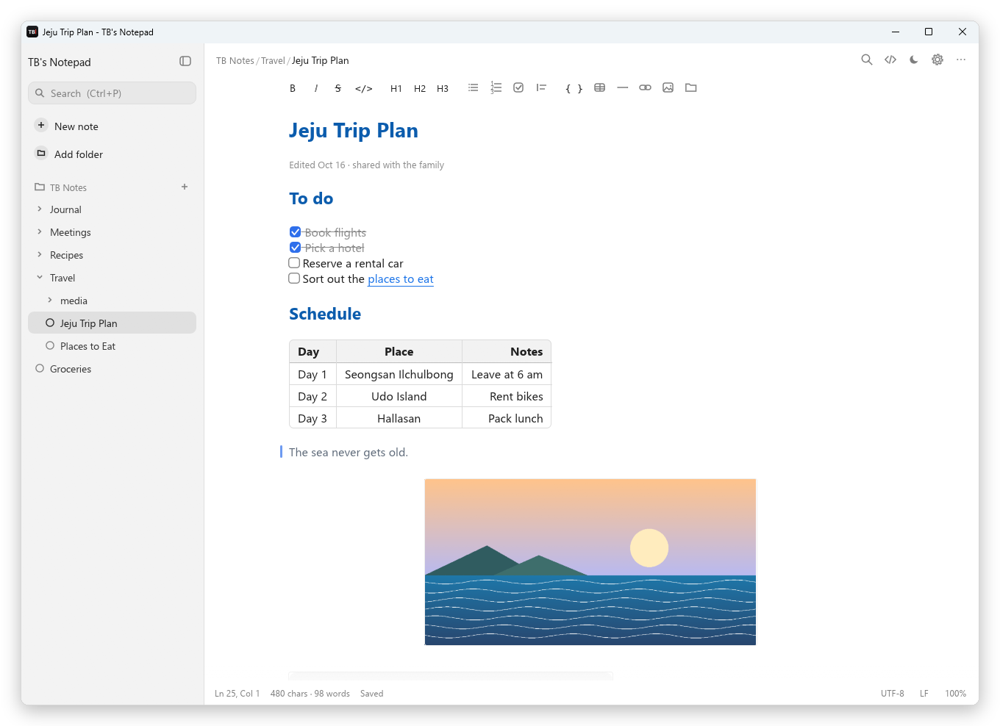
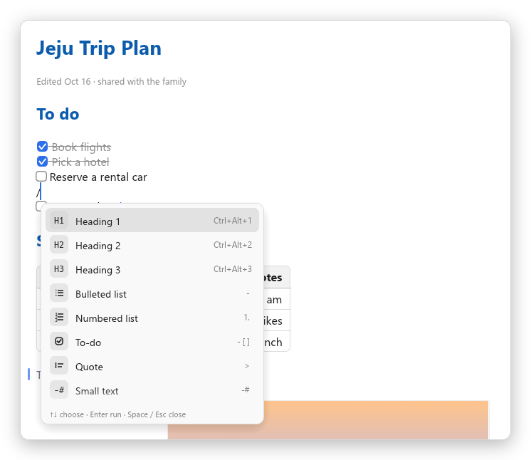
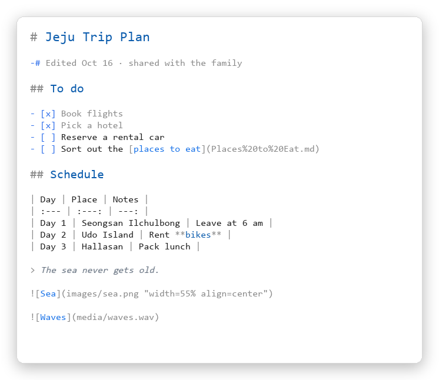
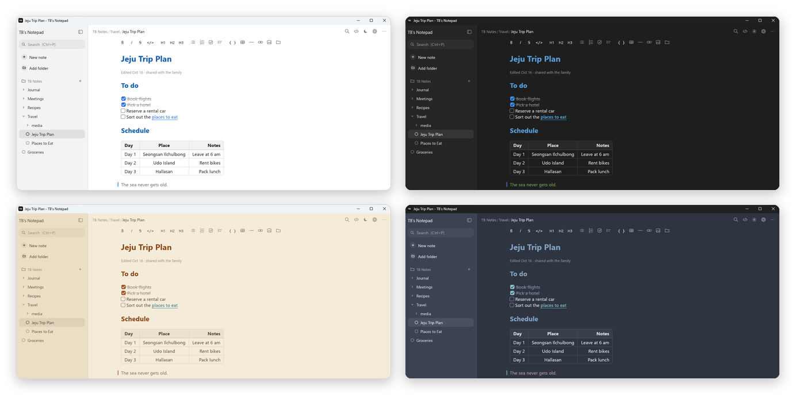

<div align="center">

**English** · [한국어](README.ko.md) · [简体中文](README.zh-CN.md) · [日本語](README.ja.md)


# TB's Notepad

**A light, easy markdown notepad for Windows — formatting shows up as you type**

[](https://github.com/tbvwv123/TB-s-Notepad/releases/latest)


[](LICENSE)

<picture>
  <source media="(prefers-color-scheme: dark)" srcset="docs/images/en/dark.png">
  
</picture>

</div>

## Why TB's Notepad?

- **What you see is what you write** — type `# Heading`, `**bold**` or `- [ ] to-do` and the symbols disappear into a real heading, bold text or checkbox. Symbols only show, faintly, on the line with the cursor.
- **Organized in folders** — folders › subfolders › notes in the sidebar. It saves as soon as you stop typing, and the first line becomes the file name.
- **Just `.md` files** — your notes are plain markdown files in folders on your PC. Use them with other editors, cloud-synced folders or Git as they are.
- **Light and quiet** — no installer, no login, a single exe (about 13 MB). It never connects to the internet.
- **Four languages** — English, 한국어, 简体中文 and 日本語. It follows your Windows language and can be changed in Settings › Editor.

## Features

<table>
<tr>
<td width="50%" valign="top">

### ✍️ Edit like a document
Headings · lists · to-dos · quotes · code blocks · dividers · `-#` small text show up right away.
**Tables** are drawn with cells and lines, and turn back into source when you click them.

</td>
<td width="50%" valign="top">

### 🖼️ Images · audio · video
Copy an image and press **Ctrl+V** — done. Click it to resize and move it, like in Word.
Audio plays right in the note (progress bar · volume), and videos show their first frame.

</td>
</tr>
<tr>
<td valign="top">

### 🔗 Links and tags
Ctrl+click links to other notes, specific lines, headings and folders.
Select text and right-click › **Copy hyperlink** to make a link in one step.
Write `#tags` and gather notes by tag — search `#a #b` (both), `#a OR #b` (either), `-#a` (exclude).

</td>
<td valign="top">

### ⚡ `/` commands
No shortcuts to memorize. Type `/` and run commands by name — `/table`, `/link`, `/h2`.
Type a space and it stays a plain `/`. Type `:name` for your own custom emoji.

</td>
</tr>
<tr>
<td valign="top">

### 🎨 Themes and fonts
8 themes plus custom colors. Pick body, source-view and interface fonts separately —
headings stay in your chosen font even if it has no bold style.

</td>
<td valign="top">

### 🤖 Works with AI
`TB-Notepad.exe --mcp` turns it into a **local MCP server** so AI like Claude can read and write your notes.
No cloud, no login, and it never leaves your notes folders. → [Details](docs/MCP.md)

</td>
</tr>
<tr>
<td valign="top">

### 🗂️ Lists and toggles
Enter continues lists and to-dos, Tab / Shift+Tab indent them.
Type `>>` + space for a Notion-style **toggle**; fold it with ▶ or Ctrl+Enter.

</td>
<td valign="top">

### 🛟 Move and recover
Drag notes and folders in the sidebar to move them — images and links are fixed for you.
**Previous versions** keeps snapshots while you edit, so you can restore an accidental deletion.

</td>
</tr>
</table>

<div align="center">


<br>
<sub>Left: the <code>/</code> command list · Right: the same note in source view (Ctrl+E)</sub>
<br><br>

<br>
<sub>Light · Dark · Sepia · Nord — 8 themes plus custom colors</sub>
</div>

## Getting started

1. Download `TB-Notepad.exe` from [**Releases**](https://github.com/tbvwv123/TB-s-Notepad/releases/latest).
2. Put it anywhere and run it. Nothing to install, no runtime to download.
3. On first launch it creates a `Documents\TB Notes` folder and opens a **Getting Started** note that walks you through everything.

> [!NOTE]
> The exe isn't code-signed, so Windows may show "Windows protected your PC" the first time. Click **More info › Run anyway**.

- Drag `.md` files onto the window to open them, or set TB's Notepad as the "Open with" app in Explorer.
- `.txt` files open as plain text and are saved back with their original encoding (UTF-8, UTF-16, and legacy ones like CP949, Shift-JIS, GBK, Big5 and Windows-1252, detected automatically) and line endings.
- Put a `portable.txt` file next to the exe for **portable mode**: settings are kept next to the exe.

## Syntax

| Write this | To get |
| --- | --- |
| `# Heading` `## Heading` `### Heading` | Large to small headings |
| `**bold**` `*italic*` `~~strike~~` `` `code` `` | **bold** *italic* ~~strike~~ `code` |
| `- item` · `1. item` · `- [ ] to-do` | Bulleted list · numbered list · clickable checkbox |
| `> quote` · `-# small text` · `---` | Quote bar · small gray text · divider |
| `>> Title` | Toggle that folds open and closed (saved as `<details>`) |
| `\| cell \| cell \|` + `\| --- \| --- \|` | Table (`:---:` center, `---:` right aligned) |
| `` | Image with size and position |
| `` · `` | Audio card · video card |
| `[link](https://…)` · `[Minutes](meetings/oct.md#L12)` · `[Files](C:/Files)` | Web link · link to a line in a note · Explorer link |

Also: code blocks (```` ``` ````), HTML export, find and replace, and search across file names and contents.

<details>
<summary><b>Keyboard shortcuts</b></summary>

| Key | Action |
| --- | --- |
| Ctrl+N | New note (in the current folder) |
| Ctrl+P | Search notes |
| Ctrl+\\ | Toggle sidebar |
| F2 | Rename this note |
| Ctrl+O / Ctrl+S | Open / save file |
| Ctrl+F / Ctrl+H, F3 | Find / replace, find next |
| Ctrl+B / I / K | Bold / italic / link |
| Ctrl+Alt+1–3 | Heading 1–3 |
| `/` | Command list (at line start or after a space; space closes it) |
| `:` | Custom emoji list (`:name`, or the full `:name:`) |
| Ctrl+Shift+K | Insert note link |
| Enter · Tab / Shift+Tab | Continue a list · indent / outdent list items |
| Ctrl+Enter | Fold / unfold a toggle |
| Ctrl+Shift+L | Copy hyperlink to this line (or heading) |
| Ctrl+Shift+H | `==Highlight==` |
| Ctrl+click | Follow a link (web · note · line · folder · file) |
| Ctrl+V | Paste (pastes the image if the clipboard only has one) |
| Ctrl+E | Markdown source view |
| Ctrl+wheel, Ctrl+= / - / 0 | Text size |
| Ctrl+, | Settings |
| F5 | Insert date and time |
| F11 | Full screen |

</details>

## FAQ

<details>
<summary><b>Where are my notes stored?</b></summary>

As ordinary `.md` files in the folders you add to the sidebar (by default `Documents\TB Notes`).
Pasted images are saved as PNGs in an `images` folder next to the note. Settings live in `%APPDATA%\tb-notepad`.

</details>

<details>
<summary><b>Can I use it across PCs and my phone?</b></summary>

Put your notes folder inside a synced folder such as Google Drive, OneDrive or Dropbox.
The app reloads notes that change outside it, and asks which version to keep if both sides changed.
On your phone, edit the same folder with any markdown editor.

</details>

<details>
<summary><b>Does it work with other markdown apps?</b></summary>

Yes. Image size and position go in the title part of standard image syntax — `` —
so images stay intact elsewhere. Links are relative, so you can move whole folders around.

</details>

<details>
<summary><b>macOS or Linux?</b></summary>

Windows 10 and 11 only for now.

</details>

## Development

Built with Rust and [egui](https://github.com/emilk/egui). See [docs/DEVELOPMENT.md](docs/DEVELOPMENT.md) for building and the code layout, and [docs/MCP.md](docs/MCP.md) for the AI (MCP) integration.

```powershell
powershell -ExecutionPolicy Bypass -File .\build.ps1   # → dist\TB-Notepad.exe
cargo test
```

See [CONTRIBUTING.md](CONTRIBUTING.md) for how to report issues or help with translations and code.

UI text lives in `scripts/i18n_strings.py`; run `python scripts/gen-i18n.py` after editing it. Translation fixes are welcome!

## License

[MIT](LICENSE) © 2026 TBvwv123

Emoji graphics: [Twemoji](https://github.com/jdecked/twemoji) (CC-BY 4.0) — see [assets/twemoji/NOTICE.md](assets/twemoji/NOTICE.md).
