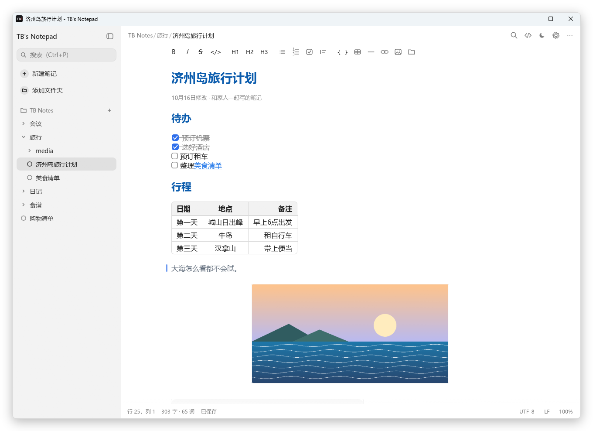
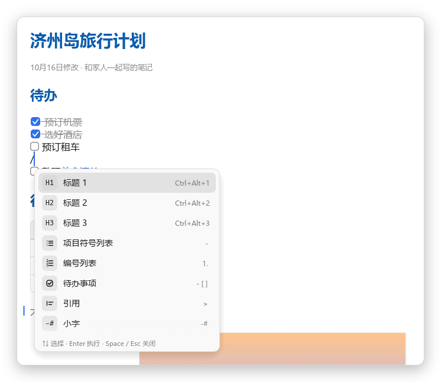
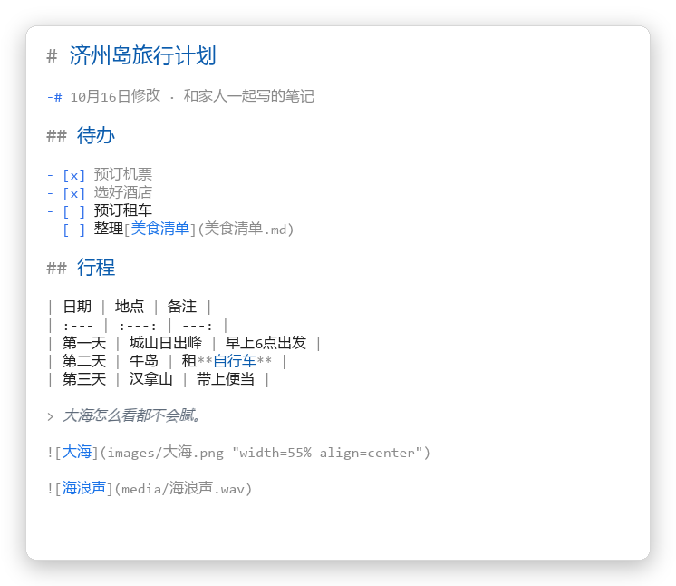
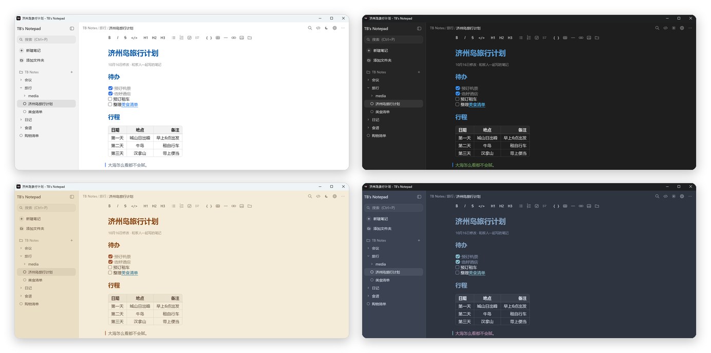

<div align="center">

[English](README.md) · [한국어](README.ko.md) · **简体中文** · [日本語](README.ja.md)


# TB's Notepad

**边写边显示格式的轻巧易用 Windows Markdown 记事本**

[](https://github.com/tbvwv123/TB-s-Notepad/releases/latest)


[](LICENSE)

<picture>
  <source media="(prefers-color-scheme: dark)" srcset="docs/images/zh/dark.png">
  
</picture>

</div>

## 为什么选择 TB's Notepad？

- **所见即所写** — 输入 `# 标题`、`**粗体**`、`- [ ] 待办`，符号会隐藏，立刻变成标题、粗体和复选框。符号只在光标所在行淡淡显示。
- **用文件夹整理** — 侧边栏里是 文件夹 › 子文件夹 › 笔记。停止输入就自动保存，第一行就是文件名。
- **就是 `.md` 文件** — 笔记以普通 Markdown 文件保存在你电脑的文件夹中，可以直接和其他编辑器、云同步文件夹或 Git 一起使用。
- **轻巧安静** — 无需安装、无需登录，只有一个 exe（约 13 MB），从不连接网络。
- **四种语言** — 简体中文、English、한국어、日本語。默认跟随 Windows 语言，可在 设置 › 编辑器 中切换。

## 主要功能

<table>
<tr>
<td width="50%" valign="top">

### ✍️ 像文档一样编辑
标题 · 列表 · 待办 · 引用 · 代码块 · 分隔线 · `-#` 小字立即显示。
**表格** 以单元格和线条绘制，点击后变回源码即可修改。

</td>
<td width="50%" valign="top">

### 🖼️ 图片 · 音频 · 视频
复制图片后按 **Ctrl+V** 即可。像 Word 一样点击调整大小和位置。
音频可直接在笔记中播放（进度条 · 音量），视频会显示首帧画面。

</td>
</tr>
<tr>
<td valign="top">

### 🔗 笔记之间的链接
Ctrl+点击即可跳到其他笔记、某一行、标题或文件夹。
选中文字后右键 › **复制超链接**，一步生成链接。

</td>
<td valign="top">

### ⚡ `/` 命令
不用记快捷键。输入 `/` 后按名称查找并执行 — `/表格`、`/链接`、`/h2`。
输入空格则保留为普通的 `/`。

</td>
</tr>
<tr>
<td valign="top">

### 🎨 主题与字体
8 种主题 + 自定义颜色。可分别选择正文、源码视图和界面字体，
即使字体没有粗体样式，标题也会保持所选字体并显示为粗体。

</td>
<td valign="top">

### 🤖 与 AI 一起使用
`TB-Notepad.exe --mcp` 即可成为 **本地 MCP 服务器**，让 Claude 等 AI 读写你的笔记。
无需云端和登录，也不会离开你的笔记文件夹。→ [详细说明](docs/MCP.zh-CN.md)

</td>
</tr>
</table>

<div align="center">


<br>
<sub>左：<code>/</code> 命令列表 · 右：同一篇笔记的源码视图 (Ctrl+E)</sub>
<br><br>

<br>
<sub>浅色 · 深色 · 棕褐 · Nord — 共 8 种主题 + 自定义颜色</sub>
</div>

## 开始使用

1. 从 [**Releases**](https://github.com/tbvwv123/TB-s-Notepad/releases/latest) 下载 `TB-Notepad.exe`。
2. 放在任意位置并运行。无需安装，也不需要另外下载运行库。
3. 首次运行会创建 `文档\TB Notes` 文件夹，并打开介绍全部用法的 **入门指南** 笔记。

> [!NOTE]
> 程序没有代码签名，首次运行时 Windows 可能显示“Windows 已保护你的电脑”。点击 **更多信息 › 仍要运行** 即可。

- 可以把 `.md` 文件拖到窗口上打开，或在资源管理器中设为“打开方式”。
- `.txt` 文件按纯文本打开，并按原编码（UTF-8、ANSI 等）和原换行符保存。
- 在程序旁放一个 `portable.txt` 文件即为 **便携模式**，设置会保存在程序旁。

## 支持的语法

| 这样写 | 显示为 |
| --- | --- |
| `# 标题` `## 标题` `### 标题` | 从大到小的标题 |
| `**粗体**` `*斜体*` `~~删除线~~` `` `代码` `` | **粗体** *斜体* ~~删除线~~ `代码` |
| `- 项目` · `1. 项目` · `- [ ] 待办` | 项目符号列表 · 编号列表 · 可点击的复选框 |
| `> 引用` · `-# 小字` · `---` | 引用竖条 · 灰色小字 · 分隔线 |
| `\| 单元格 \| 单元格 \|` + `\| --- \| --- \|` | 表格（`:---:` 居中，`---:` 右对齐） |
| `` | 指定大小和位置的图片 |
| `` · `` | 音频卡片 · 视频卡片 |
| `[链接](https://…)` · `[会议记录](会议/10月.md#L12)` · `[资料](C:/资料)` | 网页链接 · 指向笔记某一行的链接 · 资源管理器链接 |

此外还支持代码块（```` ``` ````）、导出为 HTML、查找替换，以及按文件名和内容搜索。

<details>
<summary><b>快捷键</b></summary>

| 按键 | 功能 |
| --- | --- |
| Ctrl+N | 新建笔记（在当前文件夹） |
| Ctrl+P | 搜索笔记 |
| Ctrl+\\ | 打开 / 关闭侧边栏 |
| F2 | 重命名当前笔记 |
| Ctrl+O / Ctrl+S | 打开 / 保存文件 |
| Ctrl+F / Ctrl+H, F3 | 查找 / 替换，查找下一个 |
| Ctrl+B / I / K | 粗体 / 斜体 / 链接 |
| Ctrl+Alt+1–3 | 标题 1–3 |
| `/` | 命令列表（在行首或空格后；空格关闭） |
| Ctrl+Shift+K | 插入笔记链接 |
| Ctrl+Shift+L | 复制此行（或标题）的超链接 |
| Ctrl+点击 | 打开链接（网页 · 笔记 · 行 · 文件夹 · 文件） |
| Ctrl+V | 粘贴（剪贴板只有图片时粘贴图片） |
| Ctrl+E | Markdown 源码视图 |
| Ctrl+滚轮, Ctrl+= / - / 0 | 文字大小 |
| Ctrl+, | 设置 |
| F5 | 插入日期和时间 |
| F11 | 全屏 |

</details>

## 常见问题

<details>
<summary><b>笔记保存在哪里？</b></summary>

以普通 `.md` 文件保存在你添加到侧边栏的文件夹中（默认为 `文档\TB Notes`）。
粘贴的图片以 PNG 保存在笔记旁的 `images` 文件夹中。设置保存在 `%APPDATA%\tb-notepad`。

</details>

<details>
<summary><b>能在多台电脑和手机之间同步使用吗？</b></summary>

把笔记文件夹放进 Google Drive、OneDrive、Dropbox 等同步文件夹即可。
应用会自动重新载入在外部修改的笔记，两边同时修改时会询问保留哪一边。
在手机上可以用任意 Markdown 编辑器编辑同一个文件夹。

</details>

<details>
<summary><b>和其他 Markdown 应用兼容吗？</b></summary>

兼容。图片的大小和位置写在标准图片语法的标题部分 — ``，
所以在其他应用中图片也不会出错。链接都是相对路径，整个文件夹移动后依然有效。

</details>

<details>
<summary><b>支持 macOS 或 Linux 吗？</b></summary>

目前仅支持 Windows 10 和 11。

</details>

## 开发

使用 Rust 和 [egui](https://github.com/emilk/egui) 构建。构建方法和代码结构见 [docs/DEVELOPMENT.md](docs/DEVELOPMENT.md)（英文），AI（MCP）集成见 [docs/MCP.zh-CN.md](docs/MCP.zh-CN.md)。

```powershell
powershell -ExecutionPolicy Bypass -File .\build.ps1   # → dist\TB-Notepad.exe
cargo test
```

界面文字的翻译在 `scripts/i18n_strings.py` 中，修改后运行 `python scripts/gen-i18n.py`。欢迎改进翻译！

## 许可证

[MIT](LICENSE) © 2026 TBvwv123
